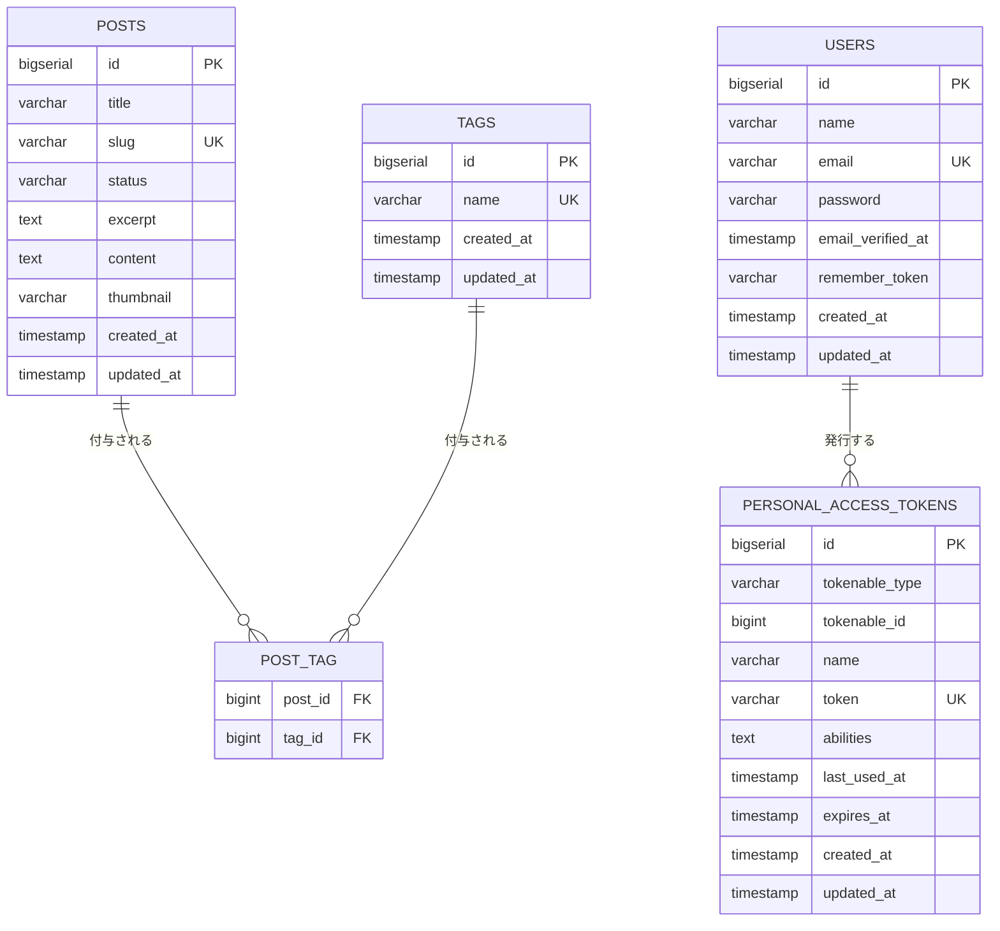

# DB設計（確定）

## DB: PostgreSQL

- ローカル: Docker Composeに`postgres`コンテナを追加
- 本番: RailwayのマネージドPostgres
- 記事・タグ・認証、すべて同じDBに統合して管理する（Markdownファイルは使わない）

## ER図

- `users`と`personal_access_tokens`の関連は、Laravel標準の`morphs`（`tokenable_type`/`tokenable_id`）によるポリモーフィック関連。通常のFKではないが、ER図上は`users`からの関連として表現している
- `posts`と`users`の間に関連はない（前述のとおり著者情報を持たない設計のため）

## テーブル

### `posts`

| カラム | 型 | 制約 | 説明 |
|---|---|---|---|
| id | bigserial | PK | |
| title | varchar | not null | |
| slug | varchar | unique, not null | URLで使う識別子。手入力、編集可（[docs/backend/slug-rule.md](./slug-rule.md)） |
| status | varchar | not null | `draft` \| `published` |
| excerpt | text | nullable | 省略時は本文先頭から自動生成 |
| content | text | not null | Markdown本文 |
| thumbnail | varchar | nullable | 画像URL（bucket上のパス） |
| created_at | timestamp | not null | |
| updated_at | timestamp | not null | |

### `tags`

| カラム | 型 | 制約 | 説明 |
|---|---|---|---|
| id | bigserial | PK | 管理用API（`PUT/DELETE /api/admin/tags/{id}`）で使用 |
| name | varchar | unique, not null | タグ名（完全一致で重複チェック） |
| created_at | timestamp | not null | |
| updated_at | timestamp | not null | |

> `posts`と`users`の間に外部キーは持たせない。管理者は1人のみのため著者情報を記録する必要がなく、スキーマを最小限に保つ。

### `post_tag`（中間テーブル、多対多）

| カラム | 型 | 制約 |
|---|---|---|
| post_id | bigint | FK → `posts.id`, on delete cascade |
| tag_id | bigint | FK → `tags.id`, on delete cascade |

複合PK（`post_id`, `tag_id`）。

### `users`（Laravel標準、変更なし）

| カラム | 型 | 制約 | 説明 |
|---|---|---|---|
| id | bigserial | PK | |
| name | varchar | not null | 表示名（例: "Admin"） |
| email | varchar | unique, not null | ログインID（`admin@example.com`） |
| password | varchar | not null | ハッシュ化済み |
| email_verified_at | timestamp | nullable | Laravel標準カラム。本アプリでは未使用 |
| remember_token | varchar | nullable | Laravel標準カラム。本アプリでは未使用 |
| created_at / updated_at | timestamp | not null | |

ログイン用の1レコードのみ。ユーザー登録機能は作らず、`database seeder`で投入する。

### `personal_access_tokens`（Sanctum標準、変更なし）

トークンの有効期限（30日）はこのテーブルの`expires_at`で管理。

画像ファイルの保存方針（ローカル`public`ディスク／本番bucket）は[docs/backend/storage-layout.md](./storage-layout.md)参照。
